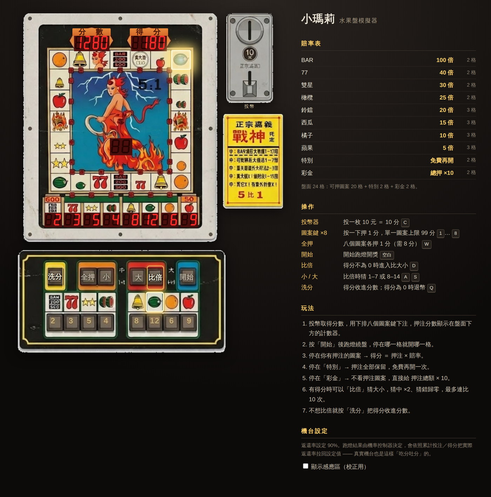

# Mô phỏng Tiểu Mary (khay trái cây)

### ▶ Chơi trực tuyến: https://pondahai.github.io/mario-slot/

Lấy ảnh bố cục gốc của máy làm màn hình chơi; màn hình LED 7 đoạn, đèn chạy và các nút bấm đều được làm thành chức năng có thể chơi được.



---

## Cách chạy

**Không cần GitHub Pages cũng chơi được.** Toàn bộ là tĩnh thuần túy, không có `fetch`/XHR nào;
ảnh dùng thẻ `` với đường dẫn tương đối, nên chỉ cần mở trực tiếp bằng trình duyệt:

```
# Cách đơn giản nhất: nhấp đúp index.html, hoặc
open index.html          # macOS
xdg-open index.html      # Linux
```

(Đã kiểm thử bằng `file://`: cả bốn ảnh đều tải, 24 ô đèn chạy và 14 nút bấm đều được tạo, console không có lỗi.)

Muốn dùng máy chủ cục bộ cũng được:

```
python3 -m http.server 8000    # rồi mở http://localhost:8000
```

### GitHub Pages

Bản trực tuyến: **https://pondahai.github.io/mario-slot/**

Dùng nhánh `gh-pages` theo cách truyền thống: khi repo công khai có nhánh `gh-pages`, GitHub sẽ
tự bật Pages và xuất bản, **không cần vào Settings bấm gì, cũng không cần Actions**.

Khi sửa xong và muốn cập nhật bản trực tuyến, đẩy `master` lên `gh-pages`:

```
git push origin master:gh-pages
```

> Ghi chú: trước đây đã thử triển khai bằng GitHub Actions (`actions/deploy-pages`) nhưng không được —
> cách đó yêu cầu trang Pages phải có sẵn, và `GITHUB_TOKEN` trong workflow dù có cấp
> `pages: write` cũng không có quyền tạo trang (`Resource not accessible by integration`),
> nghĩa là bắt buộc phải vào Settings bấm thủ công một lần. Nhánh `gh-pages` không gặp vấn đề này,
> nên workflow đó đã bị gỡ bỏ.

---

## Bố cục: ảnh gốc được cắt và sắp xếp lại như thế nào

Ảnh gốc `34d80fa1-c09c-4050-9b85-a48dfa8796fb.jpg` là một "ảnh sắp xếp chi tiết":
bảng máy, khe xu, bảng tỷ lệ và bàn phím nút bấm nằm rải rác trên nền giấy trắng; bàn phím nằm ở góc dưới bên phải và không thẳng hàng với vòng quay.

`tools/slice_assets.py` cắt bốn chi tiết thành các PNG riêng (nền được xóa thành trong suốt bằng flood fill từ biên),
rồi CSS sắp xếp lại, đưa bàn phím xuống ngay dưới bảng chính:

| Chi tiết | Tọa độ trên ảnh gốc (l, t, r, b) | Kích thước |
| --- | --- | --- |
| `assets/board.png` | 199, 72, 665, 621 | 466 × 549 |
| `assets/coin.png` | 707, 82, 819, 297 | 112 × 215 |
| `assets/sign.png` | 689, 337, 833, 564 | 144 × 227 |
| `assets/panel.png` | 460, 656, 840, 843 | 380 × 187 |

Chạy lại việc cắt ảnh:

```
python3 tools/slice_assets.py
```

### Căn chỉnh bàn phím với vòng quay

Mốc căn chỉnh là: "8 nút cược trên bàn phím" phải nằm ngay dưới "8 bộ đếm cược trên bảng".

- Tâm 8 bộ đếm trên bảng trải từ x **71.5 → 398.75** (tọa độ cục bộ của bảng)
- Tâm 8 nút cược trên bàn phím trải từ x **64.5 → 313.5** (tọa độ cục bộ của bàn phím)

Căn hai đầu cho ra tỷ lệ **1.3143** và lệch trái **−13.3**. Sau khi co giãn, bàn phím rộng 499.4,
tâm nằm ở x **236** trên bảng — đúng đường tâm của vòng quay (x 67…403, tâm 235).
Các nút ở giữa có lỗ hổng giữa các nhóm trái/phải của bàn phím nên sai số lớn nhất khoảng 14px (3% chiều rộng bàn phím).

### Tọa độ vùng cảm ứng

24 ô đèn chạy, màn hình LED 7 đoạn, bộ đếm cược và 14 nút bấm đều là tọa độ pixel đo từ ảnh gốc
(dùng profile màu để tìm đường lưới và cửa sổ LED), đổi sang phần trăm và ghi vào `styles.css`
và `script.js`, nên toàn bộ máy có thể co giãn theo tỷ lệ.

Vòng quay là lưới 7×7 đều: điểm bắt đầu cục bộ trên bảng (67, 88), rộng ô 48.0, cao ô 48.143,
đánh số 0–23 theo chiều kim đồng hồ.

Muốn kiểm tra xem căn chỉnh có bị lệch không, tick "Hiện vùng cảm ứng (để hiệu chỉnh)" ở bên phải,
khi đó mọi vùng cảm ứng sẽ được vẽ ra.

Ảnh gốc có sẵn các số cố định in trên màn LED 7 đoạn (`40` / `92` / `0` / `2`). Khi cắt ảnh, các cửa sổ này được tô thành nền đỏ sẫm
của LED đã tắt, rồi trò chơi tự vẽ số 7 đoạn bằng SVG (nét tắt tối hơn nền cửa sổ, khớp với ảnh gốc).

---

## Luật chơi

Chữ in trên bảng bị mờ trong ảnh gốc (ảnh do AI tạo), không đọc được, nên luật được đặt theo
**cách chơi phổ biến của máy Tiểu Mary thật**; nguồn tham khảo ở cuối tài liệu.

### Tám hình và tỷ lệ thưởng

| Hình | Tỷ lệ | Số ô trên bảng |
| --- | --- | --- |
| BAR | 100 lần | 2 |
| 77 | 40 lần | 2 |
| Sao đôi | 30 lần | 2 |
| Ô liu | 25 lần | 2 |
| Chuông | 20 lần | 3 |
| Dưa hấu | 15 lần | 3 |
| Cam | 10 lần | 3 |
| Táo | 5 lần | 3 |
| Đặc biệt | Quay miễn phí thêm một lần | 2 |
| Jackpot | Tổng tiền cược × 10 | 2 |

Tổng cộng 24 ô. Số ô được đếm theo số hình thực tế vẽ trên bảng trong ảnh gốc.

### Chức năng các nút

Sáu nút điều khiển hàng trên của bàn phím (vàng 1 / cam 2 / đỏ 2 / xanh 1) được bố trí theo quy ước của máy thật:

| Nút | Chức năng | Phím tắt |
| --- | --- | --- |
| Rút (vàng) | Chuyển điểm thắng vào điểm; nếu điểm thắng là 0 thì trả xu | `Q` |
| Tất cả (cam trái) | Cược 1 điểm cho cả tám hình | `W` |
| Nhỏ (cam phải) | Gấp đôi: đoán nhỏ (1–7) | `A` |
| Lớn (đỏ trái) | Gấp đôi: đoán lớn (8–14) | `S` |
| Gấp đôi (đỏ phải) | Thử gấp đôi điểm thắng | `D` |
| Quay (xanh) | Bắt đầu chạy đèn | `Space` |
| Nút hình ×8 (hàng dưới) | Bấm một lần để cược 1 điểm, tối đa 99 điểm cho mỗi hình | `1`–`8` |
| Khe xu (góc trên phải) | Bỏ một xu 10 đồng = 10 điểm | `C` |

Chữ in trên bàn phím gốc bị mờ trong ảnh nên nhãn được vẽ lại.

### Quy trình

1. Bấm khe xu để có điểm (bảng máy ghi 10 đồng).
2. Bấm nút hình để cược; số điểm cược hiển thị ngay trên bộ đếm LED tương ứng bên dưới bảng.
3. Bấm "Quay": đèn chạy quanh vòng nhiều vòng rồi giảm tốc và dừng.
4. Dừng ở hình có cược → điểm thắng = tiền cược × tỷ lệ. Ô đó nhấp nháy, nút hình tương ứng trên bàn phím cũng nhấp nháy,
   cho đến khi bắt đầu ván mới hoặc bấm Rút điểm. Nếu không trúng thì ô đó chỉ sáng đứng yên, không nhấp nháy.
5. Dừng ở "Đặc biệt" → toàn bộ tiền cược được giữ lại, ván sau quay miễn phí (số lần tích lũy hiển thị ở màn LED hai chữ số giữa).
6. Dừng ở "Jackpot" → không cần biết đã cược hình nào, trả thẳng tổng tiền cược × 10.
7. Khi có điểm thắng có thể "Gấp đôi" để đoán lớn nhỏ: mở số 1–14, Nhỏ = 1–7, Lớn = 8–14, mỗi bên một nửa.
   Đoán trúng nhân ×2 và có thể đoán tiếp; đoán sai về 0; tối đa 10 lần liên tiếp.
8. Không muốn gấp đôi thì bấm "Rút điểm" để chuyển điểm thắng vào điểm.

Nhãn "5 đổi 1" trên bảng tỷ lệ dùng cho việc trả xu: 5 điểm đổi 1 xu.

### Tiến trình được ghi nhớ

Đóng tab rồi mở lại, máy vẫn tiếp tục như cũ: điểm, điểm thắng, tiền cược trên bàn, số lần "Đặc biệt" tích lũy,
vị trí đèn đang dừng, và **trạng thái bộ điều khiển xác suất** (`gamma`, tổng cược/tổng điểm trả) đều được lưu trong
`localStorage` với khóa `marioSlotSave`.

Phải lưu trạng thái bộ điều khiển. Nếu chỉ lưu điểm, tải lại trang sẽ xóa trí nhớ ăn/nhả điểm của máy,
và người chơi có thể đặt lại bộ điều khiển về 0 chỉ bằng cách tải lại trang, khi đó bộ điều khiển không còn tác dụng.

Lúc đèn đang quay và lúc đang mở số gấp đôi là các trạng thái trung gian của hoạt ảnh nên không lưu; nếu tắt đúng lúc đó,
khi mở lại máy sẽ quay về trạng thái ổn định trước đó (tiền cược vẫn còn, ván đó coi như chưa diễn ra).
Nếu tắt khi đang gấp đôi, khi mở lại sẽ ở trạng thái "có điểm thắng", để người chơi tự quyết có đoán tiếp hay không.

Không có nút "xóa dữ liệu" riêng: **bấm Rút điểm rồi trả xu tức là reset máy**, giống máy thật.
Lần đầu mở máy (chưa có dữ liệu lưu) sẽ được tặng 100 điểm.

---

## Xác suất mở thưởng: vì sao không dùng số ngẫu nhiên đều

Với bảng tỷ lệ này, nếu mở thưởng bằng số ngẫu nhiên đều thì **không ổn**: BAR chiếm 2 trên 24 ô và trả 100 lần,
nên kỳ vọng khi chỉ cược BAR là 100 × 2/24 ≈ 833%. Cược cả tám hình thì chắc chắn thắng.

Máy Tiểu Mary thật vốn không dùng số ngẫu nhiên đều: chủ máy có thể đặt tỷ lệ hoàn trả, và bộ điều khiển
dùng cơ chế "ăn điểm/nhả điểm" để kéo tổng tiền trả về giá trị đã đặt. Trò chơi này làm theo cơ chế đó (`pickCell()` / `updateController()`):

Mỗi ván tính cho 24 ô riêng lẻ "nếu dừng ở ô này thì phải trả bao nhiêu", và trọng số là

```
weight = tần suất cơ bản × exp(gamma × payout / tổng cược)
```

`gamma` là trạng thái tích lũy của bộ điều khiển, mỗi ván được chỉnh theo chênh lệch giữa "phí thu lẽ ra phải có" và "điểm thực tế đã trả".
Trả quá nhiều → `gamma` đi xuống → các ô trả nhiều bị đè xuống theo hàm mũ, máy bắt đầu ăn điểm;
trả chưa đủ → `gamma` đi lên → các ô đó được khuếch đại, máy bắt đầu nhả điểm.

Hai điểm quan trọng khi cài đặt:

1. `gamma` phải nhân với payout để thay đổi "độ dốc" của trọng số. Nếu chỉ cộng cùng một độ lệch cho mọi ô,
   bước chuẩn hóa softmax sẽ triệt tiêu nó và không còn tác dụng điều khiển.
2. Dùng tích phân (cộng dồn sai số qua các ván) thay vì tỷ lệ (lấy trực tiếp sai số làm hệ số khuếch đại). Điều khiển tỷ lệ sẽ dừng
   ở điểm mà "sai số × hệ số" vừa đủ giữ, để lại một độ lệch ổn định cố định.
3. Lượt "Đặc biệt" miễn phí vẫn trả điểm nhưng không thu tiền, nên ván đó phải ghi `charged = 0`;
   nếu không, lượt miễn phí sẽ làm tăng tỷ lệ hoàn trả một cách giả tạo.

Kết quả đo được (mỗi chiến lược 20000 ván, đặt `CONFIG.targetRTP` là 0.80 / 0.90 / 0.97):

| Chiến lược | Mục tiêu 0.80 | Mục tiêu 0.90 | Mục tiêu 0.97 |
| --- | --- | --- | --- |
| Cược cả tám hình | 0.799 | 0.899 | 0.969 |
| Cược ngẫu nhiên vài hình | 0.797 | 0.899 | 0.968 |
| Chỉ cược BAR | 0.792 | 0.894 | 0.963 |
| Chỉ cược Táo | 0.797 | 0.897 | 0.967 |

Muốn điều chỉnh máy, sửa `CONFIG` ở đầu `script.js`:

```js
targetRTP: 0.90,   // Tỷ lệ hoàn trả đặt cho máy
steer: 0.03,       // Tốc độ tích lũy của bộ điều khiển, lớn thì chỉnh nhanh hơn, dao động ít hơn
```

Lưu ý thêm: khi cược cả tám hình, để giữ tỷ lệ hoàn trả máy sẽ mở ra Táo rất nhiều (khoản trả thấp nhất),
nên **cược cả tám hình là cách chơi rất kém** — điều này cũng đúng với máy thật.

---

## Âm thanh: cắt từ một đoạn ghi âm liên tục

`tools/slice_audio.py` cắt bản ghi âm máy thật thành các hiệu ứng âm thanh của trò chơi, theo cùng một quy trình với việc cắt ảnh:
nguồn giữ nguyên, quy tắc cắt viết thành văn bản thuần, chạy lại là ra kết quả giống hệt.

Thư viện cần thiết (cài bằng pip, không cần quyền hệ thống):

```
pip install imageio-ffmpeg numpy pillow
```

### Ba bước

```
# 1. Tự động tìm xem "âm thanh nằm ở đâu"
python3 tools/slice_audio.py analyze audio/src/raw.mp4
#    → audio/work/segments.tsv   danh sách đoạn ứng viên
#    → audio/work/waveform.png   dạng sóng có đánh số
#    → audio/work/preview/*.wav  file nghe thử của từng đoạn

# 2. Sửa segments.tsv: đổi cột name thành tên chính thức, xóa dòng không cần, rồi cắt
python3 tools/slice_audio.py cut audio/src/raw.mp4
#    → audio/clips/*.wav

# 3. Đóng gói thành một file + bảng độ lệch
python3 tools/slice_audio.py sprite
#    → assets/audio/sprite.mp3 / sprite.ogg / sprite.json
```

**Máy chỉ tự tìm được "biên", không biết được đoạn thứ 47 là trúng thưởng hay cược — bước giữa nhất định phải đặt tên thủ công.**

### Một số tình huống thường gặp

- **Tiếng đèn chạy bị gộp thành một khối**: đèn chạy là tiếng "bíp" lặp nhanh, khoảng cách có thể chỉ 35ms,
  nhỏ hơn mức `--min-silence 0.08` mặc định nên bị dính vào nhau. Đặt `--min-silence 0.02` để tách ra.
  Trò chơi chỉ cần **một tick sạch**, việc lặp lại do chương trình đảm nhiệm.
- **Nhiễu nền lớn**: tăng `--threshold` (ví dụ `-35`) để tránh coi tiếng ồn là âm thanh; khi cắt có thể thêm
  `--denoise` để khử nhiễu, nhưng âm sắc sẽ bị kim loại, nên tránh dùng nếu không cần.
- **Nhạc nền lọt vào**: nhạc chờ của máy thường phát liên tục, khi cắt sẽ mang theo đuôi nhạc.
  Ưu tiên chọn đoạn lúc nhạc yên lặng và chỉ có một phím được bấm.

### Âm thanh hiện đang dùng trong trò chơi

Nguồn âm là bản ghi âm máy thật, mốc thời gian nằm trong `audio/cues/machine.tsv`.

| Tên | Kích hoạt | Mô tả |
| --- | --- | --- |
| `coin` | Bấm khe xu | 1.28s, chuỗi tiếng va chạm cơ khí; bấm liên tục sẽ ngắt lần trước |
| `bet` | Nút cược, Tất cả | 0.43s |
| `tick1`–`tick4` | Đèn chạy mỗi lần qua một ô; số gấp đôi lăn | mỗi tiếng 37ms, phát luân phiên bốn tiếng |
| `win` | Trúng thưởng | 6.14s; dừng khi bắt đầu ván mới hoặc bấm Rút điểm |

Đèn chạy dùng bốn tiếng luân phiên thay vì một tiếng lặp lại — tiếng đèn chạy của máy thật là một dãy nốt
(đo được cao độ tăng dần `750 812 875 938 1000 1062 …`), lặp một tiếng sẽ rất đơn điệu.

Điểm bắt đầu của nhạc trúng thưởng đo được là **27.860** (tại 27.86 có chỗ năng lượng thấp −42.8 dB, đoạn trước kết thúc ở đó).
Điểm kết thúc 34.0 không phải là ranh giới câu nhạc — nhạc tiếp tục đến 36.5 không dừng,
các ứng viên độ dài câu tính theo tự tương quan (1.6 / 1.7 / 1.8 / 1.9 / 2.0 giây) khá phân tán,
đây là giai điệu đang phát triển chứ không phải câu nhạc lặp, nên cắt theo mốc đã định và kết thúc bằng fade-out 400ms.
Cột thứ tư của cue sheet chính là thời gian fade-out tính bằng mili giây.

Chưa có nguồn âm cho: `land` `lose` `special` `bonus` `double_*` `wash` `payout`, sẽ bổ sung khi có.

### Phát âm: vì sao không dùng độ lệch trong sprite.json trực tiếp

Sau khi tải, trang web **không dùng trực tiếp** điểm bắt đầu trong `sprite.json`, mà tìm lại
khoảng im lặng 0.1 giây giữa các đoạn trong dạng sóng đã giải mã, từ đó tính lại biên (`Sound._mapClips`).

Lý do: có trình duyệt khi giải mã âm thanh nén sẽ thêm độ trễ của bộ mã hóa ở đầu, khiến cả bảng độ lệch
bị dịch theo; tick chỉ dài 37ms nên lệch vài chục mili giây là sai hẳn. Thử nghiệm cho thấy Chromium xử lý
thông tin gapless của mp3 và chỉ lệch −0.7ms (ogg là −5.7ms), nhưng không phải trình duyệt nào cũng vậy,
nên vẫn dùng phát hiện như một phương án bảo hiểm. Nếu số đoạn phát hiện được không khớp với dự kiến
thì quay về độ lệch của json.

Âm thanh dùng Web Audio API thay vì phần tử `<audio>`: đèn chạy nhanh nhất 34ms phát một tiếng,
độ trễ và phát lặp của `<audio>` không theo kịp.

### Đánh đổi về chất lượng âm

Cắt khoảng lặng đầu/cuối, fade-in/fade-out và chuẩn hóa mức đều làm bằng numpy, không dùng bộ lọc của ffmpeg; lý do được ghi trong code:

- Cách viết thường gặp `silenceremove,areverse,silenceremove,areverse` sẽ cắt mất cả đoạn
  (thử nghiệm: giai điệu dài 0.48s thành 0.000s).
- Chuẩn hóa động như `dynaudnorm` sẽ đẩy phần đuôi đang tắt dần lên và làm đổi âm sắc. Mục tiêu ở đây là giữ
  âm sắc máy thật, nên chỉ dùng chuẩn hóa đỉnh với hệ số cố định (mặc định −1 dBFS), độ mạnh nhẹ bên trong mỗi đoạn không đổi.
- Thêm fade-in/fade-out 3ms ở hai đầu để điểm cắt không rơi vào chỗ khác 0, tránh tiếng "tách" gây giật.

---

## File

```
index.html                 cấu trúc trang
styles.css                 bố cục và tọa độ của mọi vùng cảm ứng
script.js                  logic trò chơi, màn LED 7 đoạn, đèn chạy, bộ điều khiển xác suất
tools/slice_assets.py      cắt bốn chi tiết từ ảnh gốc
tools/slice_audio.py       cắt âm thanh từ bản ghi và đóng gói thành sprite
assets/*.png               các chi tiết đã cắt
assets/audio/              sprite âm thanh (chỉ có sau khi có nguồn âm)
34d80fa1-....jpg           ảnh bố cục gốc (nguồn để cắt ảnh, xin giữ lại)
```

---

## Tài liệu tham khảo

Luật chơi, phím bấm, quy tắc gấp đôi và giới hạn cược dựa trên:

- [【復古遊戲】經典小瑪莉超進化水果盤遊戲介紹｜錢盈娛樂城](https://blog.qywin88.com/all-articles/slot/mario-slot-machine/)
  — đút xu 10 đồng, nút hàng dưới mỗi lần bấm 1 điểm, bấm START để đèn chạy, đèn LED cạnh hình sáng lên là trúng
- [小瑪莉玩法：復古水果盤！麻仔台意思、怎麼玩？](https://www.wof888.com/post/smasllmally0912)
  — cược trên 8 hình, đèn dừng ở giải có cược là trúng, sau khi trúng có thể chọn rút điểm hoặc gấp đôi,
  gấp đôi đoán đúng nhân ×2, đoán sai về 0, xác suất 1/2
- [水果機小瑪莉：麻仔台, 老虎機（Google Play）](https://play.google.com/store/apps/details?id=com.Sapp.MaLiElephant&hl=zh_TW)
  — 8 lựa chọn cược: Táo / Cam / Ô liu (nho) / Chuông / Dưa hấu / Sao đôi / 77 / BAR,
  mỗi lựa chọn cược tối đa 99 điểm
- [【小瑪莉玩法】時代眼淚也跟上時代了](https://i88176.com/blog/lilmary20221117/)

Tỷ lệ thưởng khác nhau giữa các phiên bản máy (chính kết quả tìm kiếm cũng nói vậy), ở đây dùng bộ được lưu hành rộng nhất
5 / 10 / 15 / 20 / 25 / 30 / 40 / 100.
